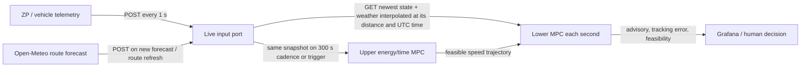

# YATA MPC 1 Hz telemetry and forecast input contract

**Protocol:** `telemetry-v1`, `route-weather-v1`, and `race-schedule-v1`  
**Purpose:** provide one coherent, validated newest state to the hierarchical MPC on each one-second controller tick.

## Data flow



The endpoint stores the latest complete telemetry sample and a separate forecast grid. A controller pull evaluates weather at the latest sample's route distance and UTC timestamp; it never reuses weather evaluated for the previous position. The route forecast itself is not fetched from Open-Meteo every second. It is refreshed when a new forecast run is available, then spatially and temporally interpolated at each one-second pull.

## Required 1 Hz telemetry

Send a complete JSON object to `POST /v1/telemetry` every second. The authoritative field and numeric bounds are in [`../schemas/telemetry-v1.schema.json`](../schemas/telemetry-v1.schema.json).

| Field | Required | Unit / rule | Use |
|---|---:|---|---|
| `schema_version`, `vehicle_id`, `sequence`, `timestamp_utc` | Yes | version `1.0`; monotonically increasing integer; RFC3339 UTC with `Z`/offset | ordering, stale detection, audit |
| `position.latitude_deg`, `longitude_deg` | Yes | WGS84 decimal degrees | map and position quality |
| `position.route_distance_m` | Yes | distance along the currently loaded official route from its declared origin | spatial forecast and route state |
| `position.route_id` | Yes | exact identifier shared with active schedule and route-weather grid | prevents solving on a mismatched route |
| `position.horizontal_accuracy_m` | Yes | meters, 50 m or better for recommendations | position quality gate |
| `speed_kmh` | Yes | km/h, ground/vehicle speed as recorded | lower MPC state and rule check |
| `hv_bus.voltage_v` | Yes | V, aggregate HV bus | battery estimate and power consistency |
| `hv_bus.battery_current_a` | Yes | A; positive means pack discharge, negative means charge | coulomb/energy estimate |
| `hv_bus.battery_power_w` | Yes | W; positive discharge, negative charge; must agree with V×A within max(10 W, 3%) | bus energy integration |
| `pv_power_w` | Yes | W; aggregate PV after all MPPTs, positive into HV bus | measured PV update and energy balance |
| `event.phase`, `event.flags` | Yes | phase enum plus zero or more event strings; use a stable prefix such as `incident[:reason]`, `control_stop[:reason]`, `traffic_stop[:reason]`, `driver_change[:reason]`, `repair[:reason]`, `charge[:reason]`, `hatch_repair[:reason]`, `fault[:reason]`, or `emergency[:reason]` | suppress advice at stops/faults |

The existing ZP channels are the reference mapping: `Main_Volt[V]`, `Battery[A]`, `Battery_Watt[W]`, `Solar_Watt[W]`, `Speed[kmh]`, and the already defined route/event state. Preserve signed values. A missing measurement is `null` only where the schema permits it; never encode missing as zero.

## Optional sensor fields

Provide ambient, battery, module, and motor temperature if fitted; PWM duty and motor mode if exposed by the controller. None is required for this version. In particular, the vehicle has no panel temperature sensor, so the interface does not invent one. If present, include a source identifier and sensor validity in the next schema revision. The MPC must mark model-derived temperature separately from a measurement.

## Separate route-weather feed

Send a route/time grid conforming to [`../schemas/route-weather-v1.schema.json`](../schemas/route-weather-v1.schema.json) to `POST /v1/forecast/route` whenever a new forecast issue is available or route geometry changes. Required top-level fields are `route_id`, `issue_time_utc`, and `points[]`; each point has route `distance_m`, valid `time_utc`, 2 m temperature, 10 m wind speed/direction, surface pressure, and GHI/DNI/DHI in SI units. The route ID must match telemetry and the active race schedule. The forecast grid must cover the active route through the upper prediction horizon: no more than 30 km between bracketing spatial nodes and no more than 3 hours to a valid-time bracket at the current sample. Use model issue time and valid time, never download/issue time in their place. Store provider, model, API request ID, and received time in the production adapter's audit log.

For current-location PV calculation, the route adapter must also supply course/heading or derive it from route geometry. Use the existing fixed-body/faceted POA PV model, not horizontal GHI alone. Forecast/model uncertainty remains attached to predicted values; the 2025 day-blocked PV MAE was about 50.5 W.

## Battery energy state from the available measurements

No true BMS SoC channel is established in the supplied telemetry. The input service therefore runs `BatteryEnergyEstimator` using the existing 25S voltage-to-SoC table, 3011 Wh theoretical capacity, and 0.488 Ω effective resistance prior. It estimates reference voltage as `V_terminal + R_eff × I` (positive current discharges), anchors from the median of valid `|I| ≤ 5 A` samples during the initial 180 s when available, and integrates signed pack power thereafter. The first voltage-derived state is marked `loaded_voltage_fallback` with wider uncertainty until a low-current anchor is formed. It never labels this estimate as BMS SoC.

The upper optimizer constrains against `energy_lower_2sigma_wh`, not the point estimate. If the estimate is uninitialized, the optimizer returns no advisory. The temperature dependence and aging state of the pack remain represented as uncertainty because cell temperature and a traceable SoC calibration are not available.

## Active road-day schedule for the upper MPC

Before road-day advice is enabled, send a payload conforming to [`../schemas/race-schedule-v1.schema.json`](../schemas/race-schedule-v1.schema.json) to `POST /v1/race-schedule` with the currently active schedule: matching `route_id`, schedule validity interval, day-end route distance, UTC deadline, reserve target, and each remaining Control Stop's route distance and expected dwell time. Replace the schedule when the official route/day plan changes. `GET /v1/controller/advice` starts the upper MILP asynchronously at startup and every 300 s, on a new forecast issue, after 10 km of travel, or after a tracking/energy trigger. The MILP reads the newest state, lower-two-sigma battery energy estimate, full latest route/time weather grid, loaded route elevation/heading, and active schedule. It returns no advice while solving or if it cannot find a plan satisfying the same reserve and deadline constraints. The API refuses to solve if route IDs disagree.

## Timing, validity, and fail-safe behavior

- Telemetry expected cadence: 1.0 s. Sequence and UTC time must increase strictly.
- `GET /v1/controller/input` is the controller's pull boundary. It returns the latest state and fresh route-weather interpolated at that state's current distance/time, plus fitted 2025 vehicle-load and fixed-body PV power predictions and their residual against measured battery power.
- State older than 2.5 s, invalid HV power consistency, GPS accuracy worse than 50 m, missing route/weather coverage, a stop/fault phase, or an out-of-range state must return not-ready; do not emit a new speed advisory from stale data.
- A sequence gap over 2.5 s is a controller quality warning even if the next sample is valid. Preserve the gap in the audit trail.
- Forecast rows must preserve issue and valid time. Stale/uncertain forecast widens the model uncertainty and can suppress optimization; it must not silently reuse a weather point at the old vehicle location.
- The lower layer consumes a fresh validated state each second. The upper layer recalculates at 300 s and immediately on an event/fault, a new forecast issue, at least 10 km position advance, a sustained >3 km/h tracking deviation, or an energy-contract breach. These trigger thresholds are operating defaults, not 2025 data-optimized constants.
- The server does not expose PWM or motor actuation. Current outputs are advisory until a verified actuator map and human/vehicle safety workflow exist.

## Endpoints and local run

```text
POST /v1/telemetry          raw 1 Hz vehicle sample
POST /v1/forecast/route     route-distance x valid-time weather grid with route_id
POST /v1/race-schedule      active day endpoint, deadline, reserve, and Control Stops
POST /v1/upper-plan         optional external plan injection (max 300 s validity)
GET  /v1/telemetry/latest   latest coherent state, or 503 if not ready
GET  /v1/controller/input  current-position/time state + fitted power preview
GET  /v1/controller/advice lower-layer advisory per telemetry sequence; starts upper solve when due
GET  /api/health            service status
```

`POST /v1/upper-plan` accepts only an explicitly `advisory_eligible: true` plan whose solver status is `optimal_finite_grid_milp` or `feasible_time_limited_milp_not_proven_optimal`. Both statuses must contain an incumbent that passed the original hard energy-reserve and deadline checks. Infeasible, no-incumbent, invalid-state, and solver-error results are diagnostic records, not speed plans; they are rejected and invalidate any previously stored upper plan. A scalar lower-layer problem with no acceleration satisfying both actuator and horizon-end speed bounds returns HTTP 503 with `lower_mpc_infeasible_no_advisory`, never a fabricated zero-acceleration recommendation. The plan is route-distance indexed, so the selected target is re-read at the newest odometer/GPS-matched distance.

Example telemetry shape (values are illustrative; the power/current signs follow the rule above):

```json
{
  "schema_version": "1.0",
  "vehicle_id": "YATA",
  "sequence": 1024,
  "timestamp_utc": "2026-10-02T17:00:00Z",
  "position": {
    "latitude_deg": -12.4,
    "longitude_deg": 130.8,
    "horizontal_accuracy_m": 4.0,
    "route_distance_m": 125000.0,
    "route_id": "BWSC2027-current-route"
  },
  "speed_kmh": 70.0,
  "hv_bus": {"voltage_v": 100.0, "battery_current_a": 1.2, "battery_power_w": 120.0},
  "pv_power_w": 550.0,
  "event": {"phase": "road_day", "flags": []},
  "sensors": {"module_temperature_c": null, "motor_pwm_duty_pct": null, "motor_mode": "PWM_ECO"},
  "quality": {"gps_valid": true, "hv_valid": true, "pv_valid": true}
}
```

Every upper plan segment must provide non-overlapping `[start_distance_m, end_distance_m)` and a target in the current 2025 replay bounds (60–78.2 km/h). The route-specific regulation layer must update those bounds before BWSC2027 deployment.

Run locally from the project directory:

```powershell
python scripts/mpc_live_input_api.py
```

The default listener is loopback `127.0.0.1:8125`. For an actual race network, put it behind an authenticated, access-controlled service and a durable audit log; do not expose this development HTTP listener directly to a public or shared network.

## Verification boundary

The live intake server and interpolation port are implemented in `scripts/mpc_live_input_api.py`, `src/yata_mpc/telemetry.py`, `src/yata_mpc/controller.py`, and `src/yata_mpc/battery_state.py`. `GET /v1/controller/advice` consumes the newest state, route/time weather, fitted 2025 power preview, estimated pack energy, active road-day schedule, and full weather horizon. It starts a background upper MILP when due and applies the lower speed MPC once per new telemetry sequence after a feasible upper plan is available. The API suppresses advice while solving, when no feasible upper plan exists, or when no lower-layer feasible move exists. It does not connect to an installed vehicle controller or publish actuation. The BWSC2025 archive has 5 s records, so it cannot validate packet-loss, 1 Hz control timing, network failover, sensor timestamp quality, or driver response to the advisory. Those are integration acceptance criteria, not historical results.
